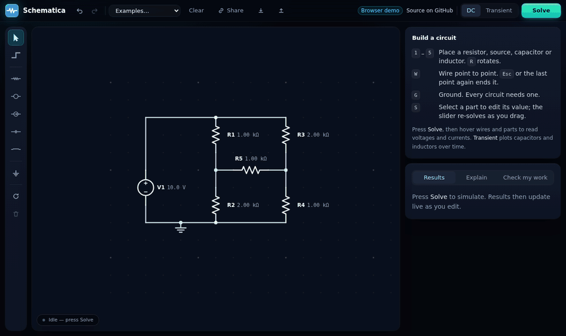
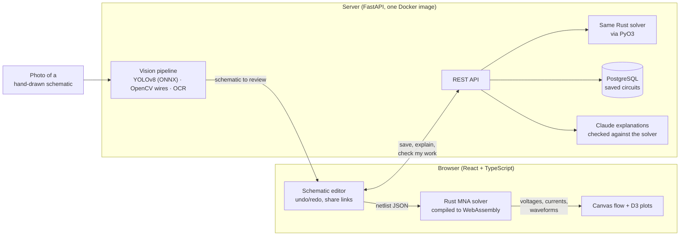

# Schematica

[](https://github.com/Shaj2x/schematica-circuits/actions/workflows/ci.yml)

A circuit simulator you can draw in, or start from a photo of a hand-drawn
schematic. It solves the circuit in your browser, shows current flowing
through the wires, and explains the solution step by step.

**Try it:** https://shaj2x.github.io/schematica-circuits/ (the browser half:
drawing, the WebAssembly solver and live plots). The full app, with saved
circuits, explanations, answer checking and photo input, runs from one Docker
image: see [Deploying](#deploying).



## What it does

- **Draw and simulate.** Place resistors, sources, capacitors and inductors
  on a grid, wire them, and solve at DC or over time. The solver is Rust
  (Modified Nodal Analysis) compiled to WebAssembly, so every edit and slider
  drag re-solves in well under a frame.
- **See the circuit work.** Wires take the colour of their voltage, and dots
  flow along them at a speed set by the actual current in each wire segment
  (from KCL on the wire network). Hover any part or wire for exact readouts.
- **Transient plots.** Capacitor charging, RLC ringing: voltage and current
  waveforms with a shared time cursor that also drives the circuit readouts.
- **Learn from it.** Step-by-step nodal analysis for any circuit, and
  "check my work" that says which of your hand-calculated answers are wrong
  and the likely mistake. With an API key, Claude writes the explanations;
  every number in them is checked against the solver.
- **Start from a photo.** A YOLOv8 detector, OpenCV wire tracing and OCR turn
  a photo into an editable schematic, with every guess flagged for review.
- **A real editor.** Undo/redo, drag to move, keyboard shortcuts, share a
  circuit as a link, export and import files, save to the server.

## Roadmap

| Phase | Scope | Status |
|-------|-------|--------|
| 1 | DC solver core in Rust (Modified Nodal Analysis) | ✅ Done |
| 2 | WebAssembly build + React editor with live re-solve | ✅ Done |
| 3 | Transient analysis (capacitors, inductors) | ✅ Done |
| 4 | FastAPI backend, saved circuits, AI explanations | ✅ Done (Claude-written explanations switch on with an API key) |
| 5 | Computer vision: photo → editable schematic | ✅ Done (needs a trained model: see [ml/README.md](ml/README.md)) |
| 6 | Docker, CI, deployment, benchmarks | ✅ Done ([benchmarks](docs/benchmarks.md); detection accuracy is filled in by the training run) |

## Architecture



One solver, written once in Rust, runs in two places: in the browser (WebAssembly)
so editing re-solves instantly with no server round trip, and on the server
(PyO3) so explanations and answer checking use exactly the same numbers. Both
builds are tested against the same hand-derived fixtures.

## Benchmarks

Full tables and how to reproduce them: [docs/benchmarks.md](docs/benchmarks.md).

- **Accuracy:** agrees with ngspice 41 to 4.5e-9 (relative) on 213 DC circuits, the
  residual being ngspice's own `gmin`; transient (trapezoidal) agrees to better than 3e-5.
- **Speed:** a 145-node circuit solves in 0.39 ms natively and 0.95 ms in the browser
  including the JSON round trip; editor-sized circuits take tens of microseconds.
- **Detection:** per-class precision, recall and mAP on held-out drafters, generated by
  `bench/detection_report.py` once the model is trained.

## Repository layout

```
solver/        Rust crate: netlist format + MNA solver
solver-wasm/   WebAssembly bindings (wasm-bindgen), for the browser
solver-py/     Python bindings (PyO3), for the backend
frontend/      React + TypeScript editor
backend/       FastAPI + Postgres: saved circuits, explanations, check my work
ml/            Photo → schematic pipeline (OpenCV + ONNX) and YOLOv8 training scripts
bench/         Benchmarks: ngspice comparison, WASM timing, detection report
docs/          Design notes
```

## Running it

Requirements: Rust (with the `wasm32-unknown-unknown` target), wasm-pack and Node 22.12+ (required by Vite 8).

```sh
rustup target add wasm32-unknown-unknown
cargo install wasm-pack

cd frontend
npm install
npm run dev          # builds the WASM solver, then starts Vite on http://localhost:5173
```

The editor and simulation run entirely in the browser. Saving circuits,
explanations and check my work need the backend (Python 3.11+, uv, Postgres);
see [docs/backend.md](docs/backend.md#running-locally). Explanations work
without an API key, from a deterministic template. Set `ANTHROPIC_API_KEY`
in `backend/.env` to have Claude write them instead. Photo upload needs a
trained detector in `ml/weights/model.onnx`; [ml/README.md](ml/README.md)
explains how to train one on Colab in about an hour.

## Deploying

**Everything, on your machine** (Docker):

```sh
docker compose up --build        # then open http://localhost:8000
```

That builds one image (frontend, API, photo pipeline) and starts it next to
Postgres. Migrations run on start. Add `ANTHROPIC_API_KEY=...` in front for
Claude-written explanations, and put a trained `model.onnx` in `ml/weights/`
before building for photo input.

**Everything, hosted** (Render, free tier): click
[Deploy to Render](https://render.com/deploy?repo=https://github.com/Shaj2x/schematica-circuits).
`render.yaml` creates the web service and its Postgres database and wires
them together. Free services sleep when idle, so the first visit after a
while takes about a minute to wake.

### The website

`.github/workflows/pages.yml` builds the frontend with `VITE_STATIC=1` (no backend: server
features explain themselves instead of failing) and publishes it to GitHub Pages on every push
to `main`. One-time setup: Settings → Pages → Source: **GitHub Actions**.

## Tests and checks

```sh
cargo test                                   # solver: fixtures, errors, transient vs exact solutions
cargo clippy --all-targets -- -D warnings

cd frontend
npm test             # reducer, netlist derivation, units, WASM contract, UI
npm run typecheck
npm run lint

cd backend
uv run pytest        # needs Postgres (see docs/backend.md)
uv run ruff check . && uv run mypy app

cd ml
uv run --group dev pytest   # recognition pipeline on rendered circuits; no model needed
uv run --group dev ruff check . && uv run --group dev mypy schematica_vision
```

The frontend tests load the real WASM build (`npm run build:wasm` first). They
re-run the Rust fixtures through it, so the browser and native builds are
checked against the same hand-derived answers.

## Design notes

- [Netlist format](docs/netlist-format.md): the JSON contract shared by every component
- [Solver design](docs/solver.md): how MNA works here and why it is built this way
- [Frontend design](docs/frontend.md): schematic → netlist, the editor reducer, live solving
- [Backend design](docs/backend.md): server-side solving, the nodal-analysis working, grounded explanations
- [Photo to schematic](docs/vision.md): detection, wire tracing, OCR, verified layout
- [Benchmarks](docs/benchmarks.md): accuracy against ngspice, solve time, detection accuracy

## License

[MIT](LICENSE)
